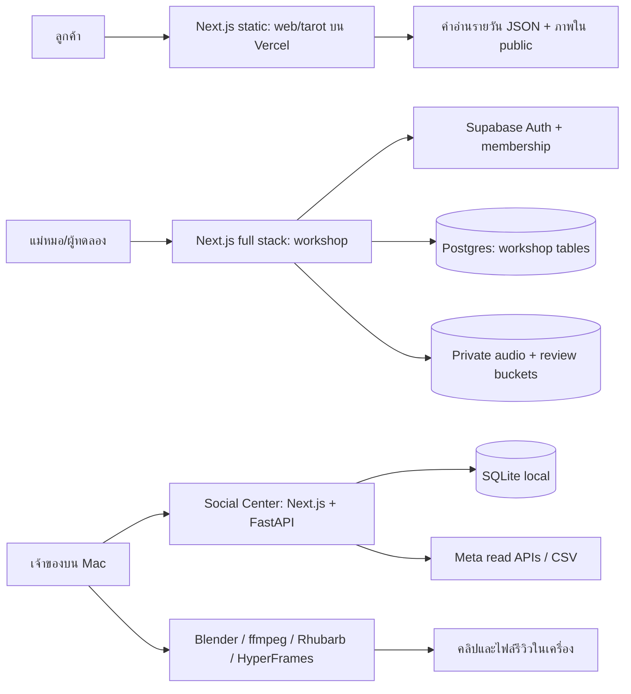
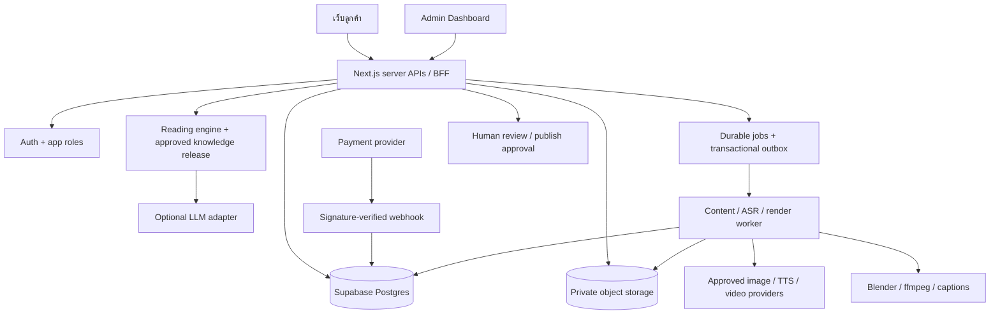

# Architecture สำหรับ review

สถานะ/ข้อเสนอ ณ 5 พ.ย. 2026. ส่วน “เป้าหมาย” ยังไม่ได้ deploy; ไม่ถือว่าตาราง/API/queue ในภาพมีอยู่แล้ว.

## ปัจจุบัน

เว็บลูกค้าไม่มีเส้นเชื่อมอัตโนมัติไปคำตอบ/เสียงของ workshop. การเลือกไพ่ลูกค้าอยู่ใน browser; `web/tarot/lib/reading.ts` เป็น demo. Social Center จำกัด localhost และมี token ใน Keychain; ย้ายไป public hosting ตรง ๆ ไม่ได้.

## เป้าหมายที่เสนอ

### ขอบเขตบริการ

- **Web/API บน Vercel:** หน้าเว็บ, login, query, คำสั่งซื้อ,ตรวจสิทธิ์, webhook และสร้าง job. หากเพิ่ม route API เข้า `web/tarot` ต้องทบทวน `output:'export'` ซึ่งใช้กับเว็บ static ปัจจุบัน; อีกทางคือ API/app แยก แล้วค่อยรวม domain
- **Postgres:** source of truth ของบัญชี/เครดิต/คำอ่าน/รุ่นความรู้/สถานะ job; เขียนการเงินใน transaction. ตารางที่ client อ่านได้ใช้ RLS พร้อม server authorization
- **Storage:** สื่อ/เสียง/วิดีโอและ artifact ไม่ใช่คอลัมน์ BLOB ในฐาน. แยก private inputs, generated drafts, approved public assets; แจก signed URL อายุสั้นผ่านสิทธิ์ที่ตรวจแล้ว
- **Reading engine:** normalize เจตนา/หมวด/สถานการณ์/ช่วงเวลา → ตรวจขอบเขต → ใช้ไพ่และตำแหน่ง → ค้น approved knowledge → ให้คำตอบหรือถามเพิ่ม → ตรวจหลักฐานก่อนคืนผล
- **Worker:** งานหนัก/ยาวทำต่อได้แม้ปิด browser. Web request ตอบ job ID แล้ว polling หรือ subscribe ดูสถานะ. เริ่มจากตัวเดียวและ template เดียว; provider adapter ไม่ผูกข้อมูลกับเจ้าเดียว

### VM / Hostinger / Coolify

ข้อเสนอเริ่มต้นคือคงเว็บ/DB ที่ใช้ได้ แล้วเพิ่ม worker เมื่อเริ่มมีงานคลิปจากเว็บ. Pilot อาจใช้ Mac เป็น worker รับงานออกไปเอง; production อาจเลือก VM/container หรือ GPU worker ตามการวัดเวลา หน่วยความจำ และเครื่องมือจริง. Coolify เป็นตัวเลือกจัดการ deployment ไม่ใช่ฐานข้อมูลหรือคิวที่แทนทุกอย่าง. ไม่จำเป็นต้องย้ายเว็บทั้งหมดเพียงเพราะมี render worker.

อย่าวาง Blender/ffmpeg ยาวทั้งคลิปใน route request เดียว. ต้องออกแบบตาม execution/runtime limits ของบริการและมี durable state; ข้อเสนอนี้อิง [Vercel Functions limits](https://vercel.com/docs/functions/limitations). จำนวนผู้ใช้ที่รับได้ต้องวัด workload/peak concurrency/DB pool/egress ไม่ใช่ประมาณจากจำนวนสมัครอย่างเดียว.

### RAG / embeddings / reranker / STT

รุ่นแรกเริ่มจาก lookup ตาม `card_id + category + intent + position + knowledge_version` ที่ตรวจ trace ได้. เพิ่ม full-text/vector/hybrid/reranker เมื่อชุดประเมินแสดงว่าการค้นเป็นจุดอ่อนและ corpus โตพอ; ยังไม่ต้องผูก architecture กับ vector store ภายนอก. STT เป็นขั้น ingest/review เสียงของแม่หมอ; ไม่ใช่เงื่อนไขที่ทำให้คำอ่านถูกโดยอัตโนมัติ. เก็บข้อความถอดเสียงกับข้อความที่คนแก้แยกกัน.

อ้างอิงการออกแบบสิทธิ์: [Supabase RLS](https://supabase.com/docs/guides/database/postgres/row-level-security), [Storage access control](https://supabase.com/docs/guides/storage/security/access-control). ตรวจเอกสารวันที่ 5 พ.ย. 2026; ตรวจข้อจำกัด/ราคาอีกครั้งตอนเลือกแพ็กจริง.
