# Dashboard และ Content Studio

## เป้าหมายของเจ้าของ

ทำงานเว็บดูดวงและช่องคอนเทนต์จาก dashboard ของตัวเอง. อนาคตเลือกซีรีส์ไพ่/ตอน/สไตล์/ตัวละคร แล้วสั่งสร้างคลิป ดู preview แก้เฉพาะช็อต และอนุมัติเผยแพร่จากเว็บได้. ปัจจุบัน pipelineคลิปทำผ่านเครื่องมือในเครื่อง; ส่วน dashboardสั่งงานนี้เป็นงานใหม่.

## เมนู dashboard ที่เสนอ

| เมนู | ข้อมูล/การกระทำ |
|---|---|
| ภาพรวม | คำถาม/งานค้าง/ยอดขาย/เครดิต/ต้นทุนจริงตามช่วงเวลา |
| คำอ่านและเคสส่งต่อ | ตรวจtrace ไพ่/ตำแหน่ง/knowledge version, ownerตอบต่อ |
| คลังความรู้ | ดูoriginal/ฉบับแก้/approval/releaseและผลประเมิน |
| คำสั่งซื้อและเครดิต | ตรวจprovider events/ledger/refund/reconciliation |
| Content Studio | ซีรีส์/ตอน/บท/storyboard/template/สั่งjob/ดูpreview/อนุมัติ |
| Asset Library | ไพ่/ตัวละคร/เสียง/เพลง/font/สิทธิ์/รุ่นและhash |
| Jobs & Costs | queue/running/failed/retry/providerID/งบจอง/ค่าใช้จริง |
| ช่องและ analytics | เชื่อมsocialบัญชีที่มีสิทธิ์/ผลโพสต์/รายงาน. SocialCenterปัจจุบันเป็นส่วนเริ่มต้นเฉพาะlocal |
| Settings / Audit | สมาชิก/role/provider credentials/server limits/budget/บันทึกการเปลี่ยน |

## Pipeline ที่มีอยู่และจะนำมาใช้

ตัวอย่าง: `animations/TheFools_Type/funmaxxing-expression-cut-v1` มี Blender scripts, timing JSON, คิวปาก, caption overlayและffmpeg compose. สร้างคลิปแนวตั้ง61วินาทีได้ในเครื่องแล้ว แต่sourceอ้างassetpathsของเจ้าของและยังไม่เป็นwebservice. GLB/.blend,เสียงจริง,วิดีโอและfontที่แจกต่อไม่ได้อยู่นอกGit. ดู READMEอ้างอิงของชุดนั้นก่อนลองrender.

Pilotควรใช้ **templateเดิมหนึ่งแบบ**: ป้อนบทที่ownerอนุมัติ/voiceที่เลือก/assetmanifest แล้วส่งออกMP4+preview+QAmanifest. จากนั้นค่อยเพิ่มขั้นเจนภาพ/3D/วิดีโออัตโนมัติ ซึ่งมีความผันผวนด้านคุณภาพ/เวลา/ราคา.

```mermaid
flowchart LR
    Brief[เลือกซีรีส์/ตอนและbrief] --> Script[บท + knowledge references]
    Script --> Approve[Ownerอนุมัติบทและงบ]
    Approve --> Job[สร้างjob + จองงบ]
    Job --> Assets[เลือกasset / เจนเมื่ออนุมัติ]
    Assets --> Audio[เสียง/เวลา/ASRหรือalignment]
    Audio --> Shots[ฉาก/กล้อง/สีหน้า/คิวปาก]
    Shots --> Render[Renderทีละช็อต]
    Render --> Compose[ซับ/ดนตรี/SFX/เครดิต/compose]
    Compose --> QA[ตรวจduration/frame/decode/sourcehash]
    QA --> Preview[Ownerดูpreviewและแก้ช็อต]
    Preview --> Publish[อนุมัติเผยแพร่แยกจากgenerate]
```

## Contractงานที่ต้องออกแบบ

- `POST /admin/content-projects/:id/jobs` สร้างงานจาก configversion/assetIDs ที่ serverตรวจสิทธิ์แล้ว. ใช้idempotency key ไม่ส่งcredentialหรือคำสั่งshellจากbrowser
- `GET /admin/jobs/:id` คืนphase/progress/currentshot/previewURLs/estimatedและactualcost
- `POST /admin/jobs/:id/retry` retryเฉพาะขั้นที่ไม่สำเร็จ โดยreuseartifactและproviderjobIDที่มีแล้ว
- `POST /admin/jobs/:id/approve` เก็บผู้อนุมัติ/assetversion/งบที่อนุมัติ. การpublishเป็นอีกสิทธิ์และอีกคำสั่ง

ทุกendpointในย่อหน้านี้เป็นข้อเสนอ ยังไม่ได้สร้าง. Workerรับtaskแบบtyped config; ห้ามexecuteโค้ดที่ผู้ใช้กรอก. ใช้allowlisttemplate/providerและตรวจinput/outputก่อนเปิดใช้จริง.

### Queue / state / recovery

สถานะเสนอ: `draft → awaiting_approval → queued → running → awaiting_review → approved → published`; มี `failed/cancelled/reconciling` ตามแต่ละขั้น. เก็บattempt/heartbeat/lease/cancellation/checkpointและartifactsแยกต่อช็อต. ออกแบบให้รับข้อความซ้ำได้: claimด้วยtransaction/leaseและเช็กstepoutputก่อนเริ่มใหม่.

หากproviderรับpaidjobแล้วresponseหาย ห้ามยิงสร้างซ้ำทันที; เก็บproviderrequestID/idempotencykeyและreconcileสถานะก่อน. คิดงบจองกับค่าใช้จริงแยกกัน; quoteราคาและขออนุมัติก่อนใช้เครดิตproviderตามกติกาโปรเจกต์. กำหนดspendcapต่อjob/วันและจำนวนพร้อมกัน. Generationไม่เท่ากับอนุมัติโพสต์ลงช่อง.

### Asset / version / reproducibility

เก็บcontenthash, source/สิทธิ์, model/provider/version, prompt/config, seedถ้ามี, voiceID, shot/เวลา, parentartifactและreview. ห้ามใช้เสียงที่เปลี่ยนแล้วกับคิวปากเก่าโดยไม่ตรวจเวลา. การแก้shotหนึ่งต้องรู้ว่าoutputใดต้องrenderใหม่และส่วนใดreuseได้. เก็บraw/edited/approvedคนละversion.

### Worker pilotและการขยาย

เริ่มMacworkerที่เข้าถึงassetเดิมได้ โดยเชื่อมคิวผ่านcredentialจำกัดสิทธิ์และดึงงานออกไป; ไม่เปิดcontrolportของMacสู่สาธารณะ. หลังวัดหนึ่งtemplateจริงค่อยเลือกVM/container/GPUและstorage. ต้องมีdependency/assetmanifestพร้อมรันซ้ำบนเครื่องใหม่ ก่อนอ้างว่าcloudrenderพร้อม. การย้ายSQLiteของSocialCenterและMetaOAuthไปserverเป็นอีกงานหนึ่งที่ต้องออกแบบAuth/tokenencryption/callback/permissionreview.
