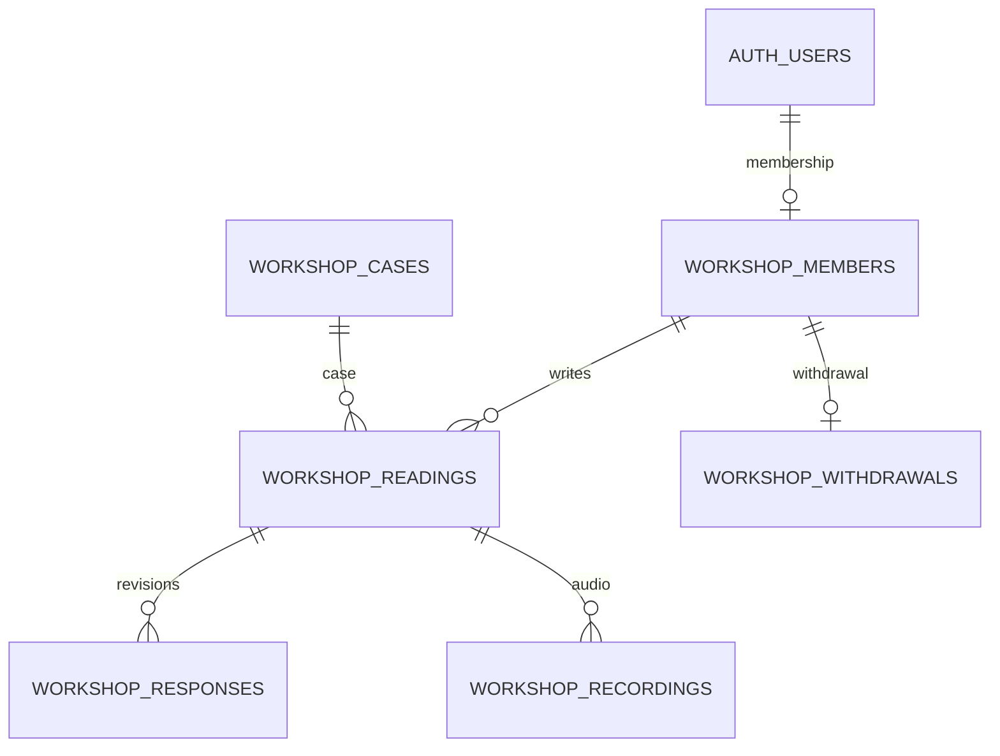

# ข้อมูลและ transaction

## ตารางที่มีจริงใน workshop

Canonical schema: [001_workshop.sql](../../web/workshop-standalone/supabase/migrations/001_workshop.sql), ตามด้วย 002/003. ข้อความโจทย์/ไพ่ catalog อยู่ใน `lib/cases.json`; `workshop_cases` เก็บ ID/version/split สำหรับตรวจความตรง.

| ตาราง | หน้าที่ / ความสัมพันธ์ |
|---|---|
| `auth.users` | Supabase Auth; `workshop_members.user_id` อ้างถึง user |
| `workshop_members` | active, role owner/reader; membership เพิ่มจากการ login สำเร็จ |
| `workshop_cases` | ID, version, development/holdout |
| `workshop_readings` | หนึ่ง draft ปัจจุบันต่อ `(reader_id,case_id)`; revision, stage, baseline/followup JSON |
| `workshop_responses` | ประวัติ revision/consent/request; FK กลับ reading, unique `(reader,case,revision)` |
| `workshop_recordings` | metadata เสียง/object key/type/size/duration/pending-ready; FK reading |
| `workshop_withdrawals` | คำขอถอนตัวและเวลาจัดการ; ผูก member |

`workshop-audio` เป็น private bucket ของเสียง. `workshop-review` เป็น private bucket แยกสำหรับ manifest/source/immutable revision JSON ของหน้า `/review` ไม่ใช่ SQL table ใหม่. มี source fingerprint และ server ตรวจ owner ก่อนใช้ privileged storage client. RLS ป้องกันการอ่านตรง ส่วน service-role ยังต้องตรวจสิทธิ์ server ทุกครั้ง.

สถานะ workflow: `baseline → followup → review` หมายถึงส่งทบทวน. ส่วน approval ในหน้า `/review` เป็นอีก workflow และเก็บประวัติแยก; ทั้งสองอย่างยังไม่เท่ากับเผยแพร่ generalized knowledge release.

## ตารางที่เสนอสำหรับเว็บจริง — ยังไม่มี migration

| กลุ่ม | แบบที่เสนอ | ข้อกำหนด |
|---|---|---|
| บัญชี/สิทธิ์ | profiles, organization_members | แยก customer/editor/reviewer/admin; ไม่ยก workshop owner เป็นสิทธิ์ทุกระบบโดยอัตโนมัติ |
| คลังแม่หมอ | knowledge_entries, knowledge_releases, style_versions, approval_events | source ID, version, scope, approver, time; draft/approved/published แยกกัน |
| คำถาม/ไพ่ | reading_sessions, reading_cards, reading_outputs | category/intent/question/time horizon, ไพ่/ตำแหน่ง/ใบขยาย, รุ่นengine/knowledge, evidence IDs |
| Payment | orders, payment_events, credit_ledger, credit_reservations | เงิน integer หน่วยสตางค์, unique provider event, immutable ledger, transaction กันจ่ายซ้ำ/หักซ้ำ |
| เนื้อหา | content_projects, episodes, scripts, assets, generation_jobs, job_attempts, cost_ledger, review_events | version/asset provenance, queue state, provider ID, cost estimate/actual, approval |
| ติดตามระบบ | audit_events, outbox_events | ผู้กระทำ/รุ่น/เวลา/เหตุการณ์; log ไม่เก็บ raw question/เสียง/secret โดยไม่จำเป็น |

รายการนี้เป็น logical model ให้ consult ตรวจ ไม่ใช่ schema ที่ deploy แล้ว. [DBML เก่า](../../backend/db/maemorkratai.dbml) ก็เป็นแบบเสนอ; ตัดสินฐานจริงจาก migrations ของแอป.

## การคิดเงินที่เสนอ

เริ่ม one-time pack ของ **เครดิตต่อคำถาม** ก่อน subscription. หนึ่งคำถามรวมอดีต–ปัจจุบัน–อนาคตและใบขยายที่ 4 ของอนาคต; การถามเพิ่มเพื่อให้โจทย์ชัดเจนไม่ควรถูกนับเป็นคำถามใหม่โดยเงียบ ๆ. คำตอบรายวันฟรีใช้เพื่อเริ่มรู้จักเว็บ.

ราคา 69/1 คำถาม, 99/3 คำถาม, 199/สัปดาห์, 399/เดือน เป็น **แนวคิดจากเจ้าของที่ยังไม่ได้เปิดขาย**. แพ็กไม่อั้นต้องตกลงขอบเขต/fair use/ต้นทุนต่อผู้ใช้หนักก่อนเสนอขายจริง. Provider เช่น Stripe ยังต้องตรวจ merchant onboarding, วิธีจ่ายที่รองรับธุรกิจ/ประเทศ/สกุลเงิน, ค่าธรรมเนียมปัจจุบันและ refund ก่อนเลือก; repo ยังไม่มี integration หรือ live checkout.

## Flow ที่ต้องทำให้ครบก่อนรับเงินจริง

1. Server สร้าง order จาก SKU/ราคาในฐาน ไม่รับราคา/จำนวนเครดิตจาก browser เป็นจริง
2. เปิด hosted checkout พร้อม order ID และ idempotency key
3. Webhook ตรวจ signature จาก raw body; บันทึก `provider_event_id` แบบ unique แล้วเปลี่ยน order และเพิ่ม ledger ใน transaction เดียว. กดหน้า success อย่างเดียวไม่เพิ่มเครดิต
4. ซื้อสำเร็จซ้ำ/เว็บฮุกซ้ำต้องเพิ่มเครดิตครั้งเดียว. รองรับเหตุการณ์มาผิดลำดับและตรวจ payment state กับ provider เมื่อจำเป็น
5. เมื่อเปิดคำถามจ่ายเงิน server จองเครดิตและล็อก reading/card draw. ใช้ request ID เพื่อกดซ้ำแล้วได้ session เดิม; การโหลดหน้าใหม่ไม่สุ่มผลใหม่/หักเพิ่ม
6. สร้างคำอ่านสำเร็จแล้ว commit การใช้เครดิตพร้อม output. ถ้าต้องถามเพิ่มให้คง session ตามเงื่อนไขที่ตกลง; หากล้มเหลวให้คืน reservation ผ่านรายการที่ตรวจได้
7. มี reconciliation job สำหรับเงินจ่ายแล้วแต่ยังไม่ได้เครดิต/งานค้าง และการคืนเงิน/chargeback/ติดลบตามนโยบายที่กำหนด

ทดสอบขั้นต่ำ: webhook replay/out-of-order, checkoutถูกปิดกลางทาง, คำขอพร้อมกัน2tab, worker crash, provider timeout, refund หลังใช้เครดิต, fail แล้ว retry โดยไม่คิดซ้ำ. อิง [Stripe webhooks](https://docs.stripe.com/webhooks); ตัว implementation ต้องยึด provider ที่เลือกจริง.

## ขอบเขตข้อมูล

แยก dev/staging/prod และไม่ clone คำตอบ/เสียงจริงมาใส่เครื่อง dev. สร้าง synthetic fixtures; ให้ consult เริ่มจาก schema และ aggregated evidence. แผน backup ต้องรวม DB/Auth/Storage ตามขอบเขตจริง พร้อมทดสอบ restore; portable intake export เดิมไม่ใช่ full database disaster recovery.
