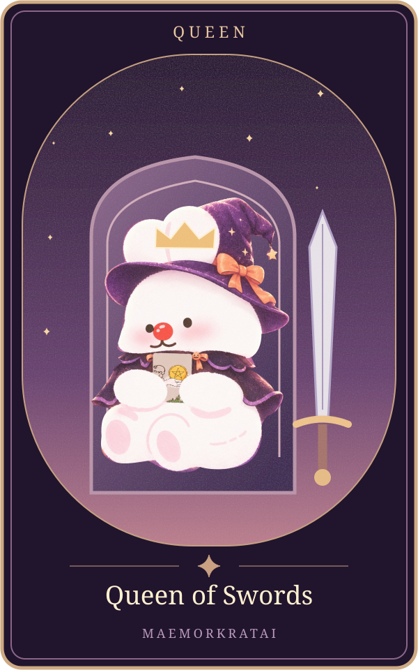

# Queen of Swords

แก่นตามต้นทาง: **ขอบเขตและความเด็ดขาด** ([[tarot-love-chat-source-2026-10-15]], message16 บรรทัด420)

ขอบเขต: ความรัก6สถานะ; ต้นทางส่วนนี้ไม่แยกไพ่กลับหัว ยังรอเจ้าของทบทวนถ้อยคำก่อนเปิดบริการจริง

| สถานะ | ความหมายตามต้นฉบับ |
|---|---|
| คนโสด | เลือกคู่ด้วยเหตุผลและมาตรฐาน |
| แอบชอบ | ชอบแต่ไม่ยอมเสียศักดิ์ศรี |
| คุยกัน | ต้องการคำตอบที่ชัดเจน |
| ซับซ้อน | ตัดสินใจเด็ดขาดต่อความสัมพันธ์ที่ไม่เหมาะสม |
| มีแฟน | พูดกันตรง ๆ และกำหนดขอบเขต |
| เลิกกัน | ตั้งกำแพง ไม่ยอมกลับไปหากไม่มีการเปลี่ยนแปลง |

ตารางถอดจากแหล่งเดียวกันทุกช่อง ([[tarot-love-chat-source-2026-10-15]])

## ภาพทดลองเวอร์ชันแม่หมอกระต่าย

ภาพประกอบออกแบบใหม่ด้วยSVGและภาพมาสคอตเดิม เป็นการตีความเชิงศิลป์ของโครงการ ไม่ใช่ภาพไพ่ดั้งเดิม มีHyperFrames+GSAPสำหรับการเคลื่อนไหว ดู[[tarot-web-prototype]]

เชื่อมโยง: [[tarot-knowledge-base]] · [[astrology]]
