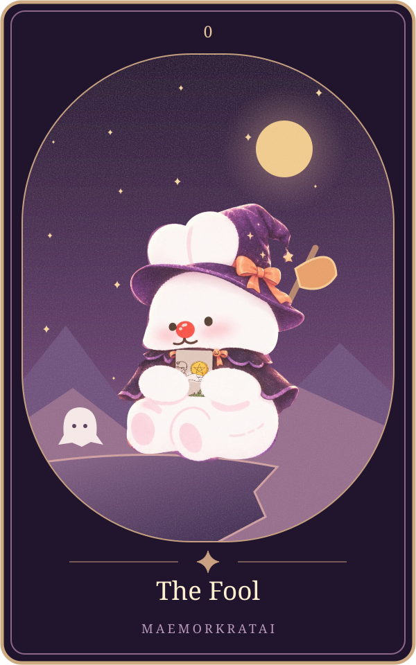

# The Fool

แก่นตามต้นทาง: **การเริ่มต้น** ([[tarot-love-chat-source-2026-10-15]], message16 บรรทัด24)

ขอบเขต: ความรัก6สถานะ; ต้นทางส่วนนี้ไม่แยกไพ่กลับหัว ยังรอเจ้าของทบทวนถ้อยคำก่อนเปิดบริการจริง

| สถานะ | ความหมายตามต้นฉบับ |
|---|---|
| คนโสด | รักใหม่กำลังมา |
| แอบชอบ | อยากลองเข้าหา |
| คุยกัน | คุยสนุกแต่ยังไม่คิดไกล |
| ซับซ้อน | ความสัมพันธ์ไร้ทิศทาง |
| มีแฟน | เติมความสดใหม่ |
| เลิกกัน | เริ่มต้นชีวิตใหม่ ไม่ยึดติดอดีต |

ตารางถอดจากแหล่งเดียวกันทุกช่อง ([[tarot-love-chat-source-2026-10-15]])

**ดูจากภาพ:** ชายหนุ่มเดินอยู่ใกล้ขอบหน้าผา มองไปข้างหน้า มีสัมภาระเพียงเล็กน้อยและมีสุนัขอยู่ข้างตัว ([[tarot-love-chat-source-2026-10-15]], message28)

**ทำไมจึงแปลแบบนี้?:** การเดินทางโดยมีสัมภาระน้อยสื่อถึงการเริ่มต้นที่ยังไม่มีประสบการณ์ ส่วนขอบหน้าผาสื่อถึงความเสี่ยงและสิ่งที่ยังไม่รู้ จึงอ่านได้ทั้งความกล้าเปิดใจและความประมาท ([[tarot-love-chat-source-2026-10-15]], message28)

**หลักจำ:** The Fool ไม่ได้แปลว่าอีกฝ่ายไม่จริงใจเสมอไป แต่ถามเราว่า *กำลังก้าวไปข้างหน้าด้วยความเปิดใจ หรือกำลังก้าวไปโดยไม่รู้ว่าตัวเองต้องการอะไร?* ([[tarot-love-chat-source-2026-10-15]], message28)

## ภาพทดลองเวอร์ชันแม่หมอกระต่าย

ภาพประกอบออกแบบใหม่ด้วยSVGและภาพมาสคอตเดิม เป็นการตีความเชิงศิลป์ของโครงการ ไม่ใช่ภาพไพ่ดั้งเดิม มีHyperFrames+GSAPสำหรับการเคลื่อนไหว ดู[[tarot-web-prototype]]

เชื่อมโยง: [[tarot-knowledge-base]] · [[astrology]]
