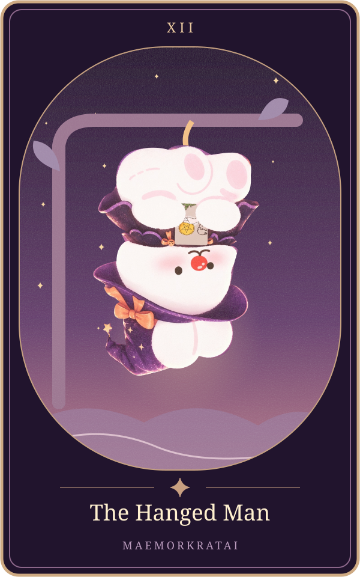

# The Hanged Man

แก่นตามต้นทาง: **การรอและการหยุดนิ่ง** ([[tarot-love-chat-source-2026-10-15]], message16 บรรทัด132)

ขอบเขต: ความรัก6สถานะ; ต้นทางส่วนนี้ไม่แยกไพ่กลับหัว ยังรอเจ้าของทบทวนถ้อยคำก่อนเปิดบริการจริง

| สถานะ | ความหมายตามต้นฉบับ |
|---|---|
| คนโสด | ยังไม่รีบมีรัก |
| แอบชอบ | รอโดยไม่กล้าขยับ |
| คุยกัน | ความสัมพันธ์ค้างคา |
| ซับซ้อน | ยอมเสียสละโดยไม่ได้สิ่งที่ต้องการ |
| มีแฟน | ต้องปรับมุมมองหรืออดทน |
| เลิกกัน | ยังปล่อยวางไม่ได้ หรือต้องใช้เวลาฟื้นใจ |

ตารางถอดจากแหล่งเดียวกันทุกช่อง ([[tarot-love-chat-source-2026-10-15]])

**ดูจากภาพ:** ชายคนหนึ่งห้อยตัวกลับหัวจากต้นไม้ แต่ใบหน้าดูสงบและมีแสงรอบศีรษะ ([[tarot-love-chat-source-2026-10-15]], message28)

**ทำไมจึงแปลแบบนี้?:** การอยู่ในท่าที่ไม่สามารถเดินหน้าตามปกติสื่อถึงการหยุดนิ่ง ขณะที่ใบหน้าสงบแสดงถึงการยอมรับสถานการณ์หรือมองสิ่งเดิมจากมุมใหม่ ([[tarot-love-chat-source-2026-10-15]], message28)

**หลักจำ:** Hanged Man คือการหยุดเพื่อมองใหม่ ไม่ใช่การรอที่รับประกันว่าจะสมหวัง ([[tarot-love-chat-source-2026-10-15]], message28)

## ภาพทดลองเวอร์ชันแม่หมอกระต่าย

ภาพประกอบออกแบบใหม่ด้วยSVGและภาพมาสคอตเดิม เป็นการตีความเชิงศิลป์ของโครงการ ไม่ใช่ภาพไพ่ดั้งเดิม มีHyperFrames+GSAPสำหรับการเคลื่อนไหว ดู[[tarot-web-prototype]]

เชื่อมโยง: [[tarot-knowledge-base]] · [[astrology]]
