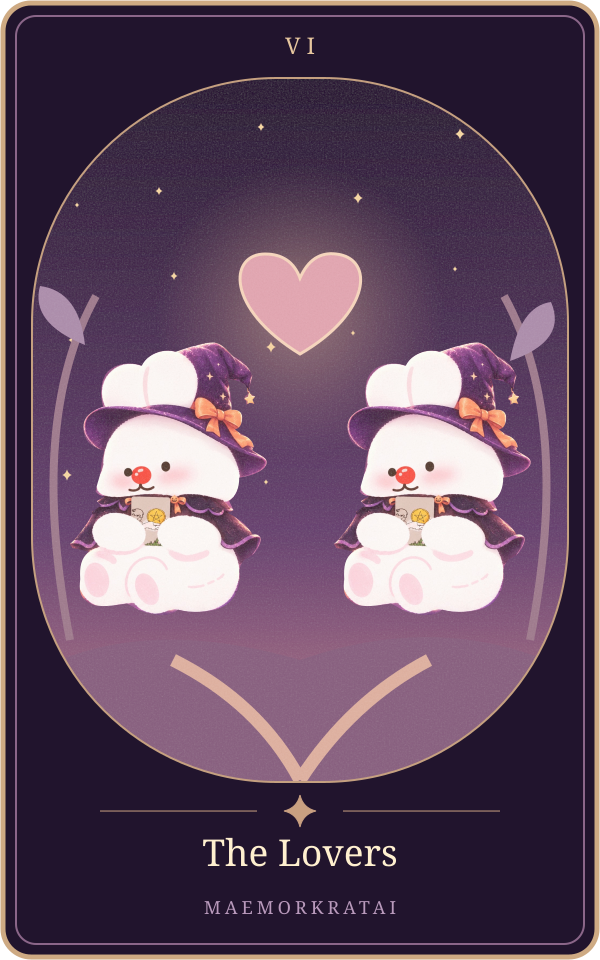

# The Lovers

แก่นตามต้นทาง: **ความรักและการเลือก** ([[tarot-love-chat-source-2026-10-15]], message16 บรรทัด78)

ขอบเขต: ความรัก6สถานะ; ต้นทางส่วนนี้ไม่แยกไพ่กลับหัว ยังรอเจ้าของทบทวนถ้อยคำก่อนเปิดบริการจริง

| สถานะ | ความหมายตามต้นฉบับ |
|---|---|
| คนโสด | มีโอกาสพบคนถูกใจ |
| แอบชอบ | แรงดึงดูดสูง |
| คุยกัน | ความรู้สึกอาจตรงกัน |
| ซับซ้อน | ต้องเลือกหรือมีรักหลายทาง |
| มีแฟน | รักกันและเลือกกัน |
| เลิกกัน | ยังมีแรงดึงดูด แต่ต้องเลือกว่าจะกลับมาหรือไปต่อ |

ตารางถอดจากแหล่งเดียวกันทุกช่อง ([[tarot-love-chat-source-2026-10-15]])

**ดูจากภาพ:** ชายและหญิงยืนแยกกันใต้เทวดา มีต้นไม้และภูเขาเป็นฉากหลัง ([[tarot-love-chat-source-2026-10-15]], message28)

**ทำไมจึงแปลแบบนี้?:** ภาพคนสองคนสื่อถึงความสัมพันธ์ ส่วนเทวดาและองค์ประกอบรอบตัวเชื่อมโยงกับการตระหนักรู้และการเลือก ไพ่ใบนี้จึงไม่ได้หมายถึงความรักอย่างเดียว แต่หมายถึงการเลือกที่จะสัมพันธ์กับใครและจะยึดถืออะไรด้วย ([[tarot-love-chat-source-2026-10-15]], message28)

**หลักจำ:** Lovers ไม่ได้แปลว่ารักสามเส้าโดยอัตโนมัติ คำว่า “การเลือก” สำคัญพอ ๆ กับคำว่า “ความรัก” ([[tarot-love-chat-source-2026-10-15]], message28)

## ภาพทดลองเวอร์ชันแม่หมอกระต่าย

ภาพประกอบออกแบบใหม่ด้วยSVGและภาพมาสคอตเดิม เป็นการตีความเชิงศิลป์ของโครงการ ไม่ใช่ภาพไพ่ดั้งเดิม มีHyperFrames+GSAPสำหรับการเคลื่อนไหว ดู[[tarot-web-prototype]]

เชื่อมโยง: [[tarot-knowledge-base]] · [[astrology]]
