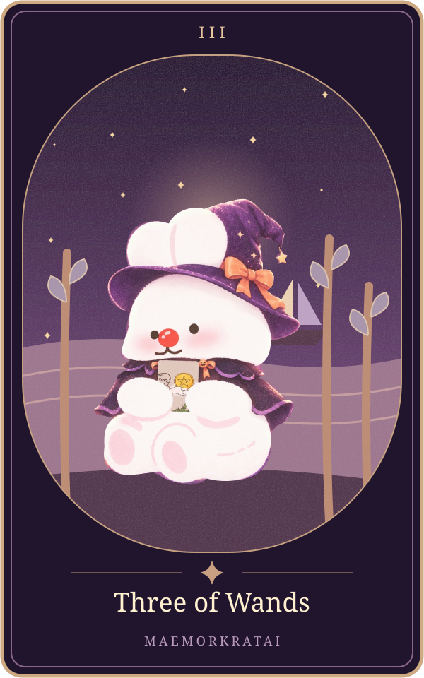

# Three of Wands

แก่นตามต้นทาง: **การรอคอย** ([[tarot-love-chat-source-2026-10-15]], message16 บรรทัด242)

ขอบเขต: ความรัก6สถานะ; ต้นทางส่วนนี้ไม่แยกไพ่กลับหัว ยังรอเจ้าของทบทวนถ้อยคำก่อนเปิดบริการจริง

| สถานะ | ความหมายตามต้นฉบับ |
|---|---|
| คนโสด | มีโอกาสพบรักผ่านสังคมหรือระยะทาง |
| แอบชอบ | รออีกฝ่ายเข้าหา |
| คุยกัน | รอความสัมพันธ์ก้าวหน้า |
| ซับซ้อน | รอคนที่ยังไม่ชัดเจน |
| มีแฟน | วางแผนอนาคตร่วมกัน |
| เลิกกัน | รอจังหวะเริ่มต้นบทใหม่ |

ตารางถอดจากแหล่งเดียวกันทุกช่อง ([[tarot-love-chat-source-2026-10-15]])

## ภาพทดลองเวอร์ชันแม่หมอกระต่าย

ภาพประกอบออกแบบใหม่ด้วยSVGและภาพมาสคอตเดิม เป็นการตีความเชิงศิลป์ของโครงการ ไม่ใช่ภาพไพ่ดั้งเดิม มีHyperFrames+GSAPสำหรับการเคลื่อนไหว ดู[[tarot-web-prototype]]

เชื่อมโยง: [[tarot-knowledge-base]] · [[astrology]]
